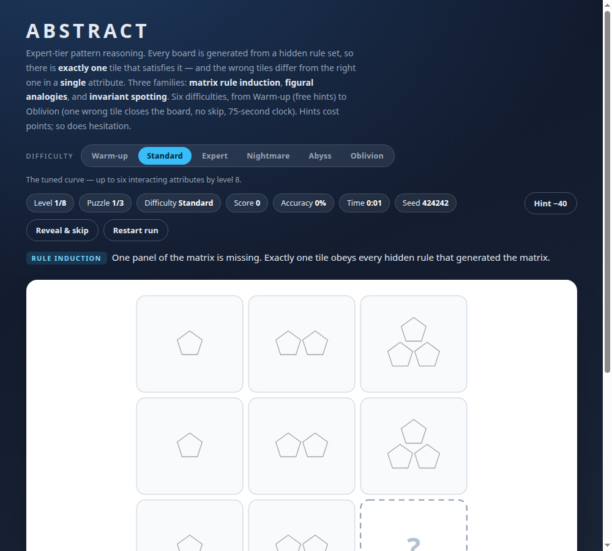
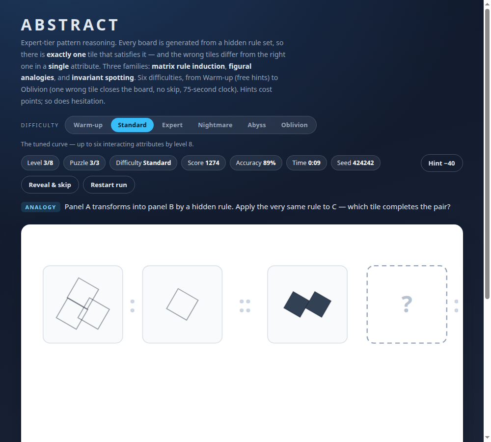
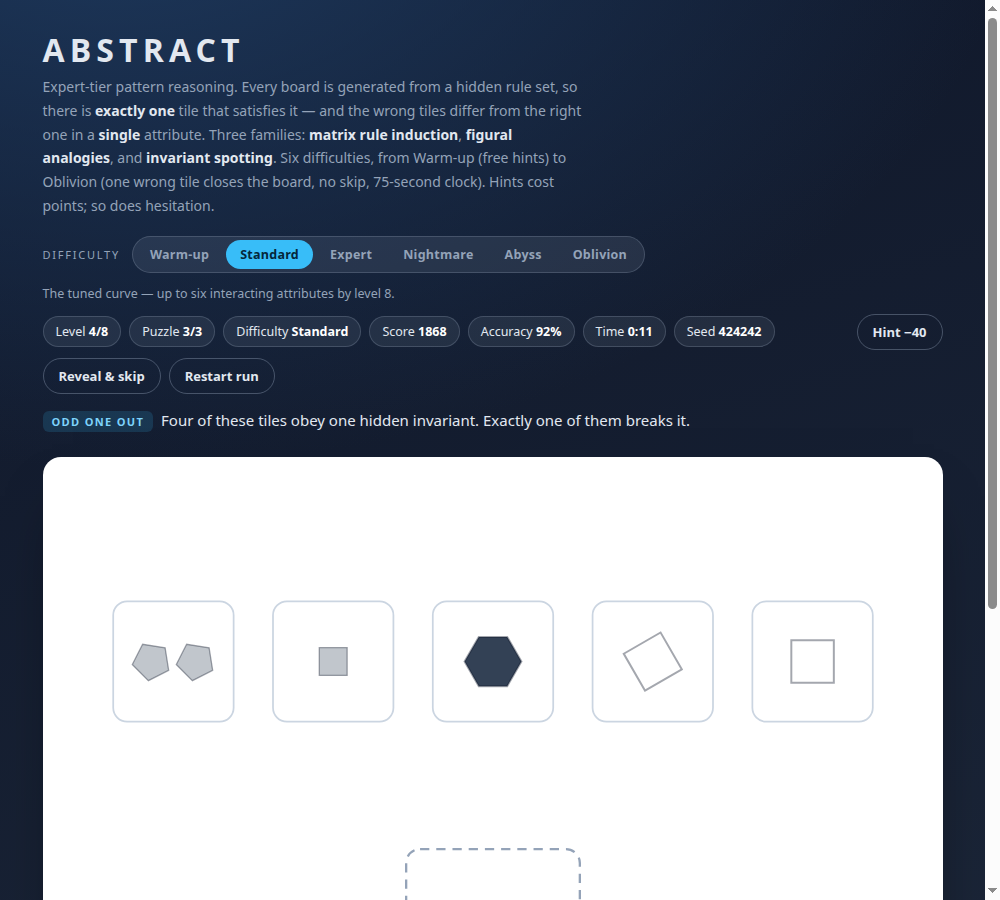

# little_games

Two self-contained browser games. No build step, no dependencies, no network — open a file and play.

| Game | File | What it is |
| --- | --- | --- |
| **Shape Match** | [`shape-match.html`](shape-match.html) | Warm-up. Drag coloured shapes into the matching slot. Pointer drag, snap tolerance, keyboard placement, per-round random layout. |
| **Abstract** | [`iq-reasoning.html`](iq-reasoning.html) | Expert pattern reasoning. Every board is generated from a hidden rule set, and every wrong tile breaks exactly one of those rules. |

## Abstract — the hard one

8 levels × 3 puzzles, three families:

- **Matrix rule induction** — up to six attributes (base shape, glyph count, rotation, size, fill style,
  secondary glyph) are each governed by a hidden rule over row and column position.
- **Figural analogy** — A → B by one or two hidden transformations; apply the same to C.
- **Odd one out** — four tiles share an invariant, one breaks it. The invariant is usually arithmetic
  (`sides + glyphs = 7`, `rotation = sides × 15°`), never a colour match.

Scoring punishes hesitation and hints: `base − wrongCost per wrong tile − hint cost per hint + speed bonus`.
Add `?seed=12345` to the URL to replay or share an identical run.

### Difficulty settings

Difficulty is a generator setting, not a score multiplier — it changes how many attributes are in play,
how subtle a rule may be, how many near-identical tiles you must reject, and what help is available:

| Difficulty | Attributes | Tiles | Hints | Speed-bonus window | Extra pressure |
| --- | --- | --- | --- | --- | --- |
| **Warm-up** | 2–3 | 4–5 | free | 60 s | — |
| **Standard** | 2–6 (tuned curve) | 4–6 | −40 | 45 s | — |
| **Expert** | 3–6, rotation from level 1 | 5–6 | −60 | 35 s | — |
| **Nightmare** | 6 on every board | 6 | disabled | 25 s | — |
| **Abyss** | 6 on every board | 6 | disabled | 20 s | second-tier rules, ≥4 attributes must genuinely vary, 2 attempts per board, 90 s clock |
| **Oblivion** | 6 on every board | 6 | disabled | 15 s | ≥5 varying attributes, **one** attempt, 75 s clock, **no skip**, 4 boards per level |

The top two rungs unlock a rule tier the easier settings never generate: patterns anchored on the centre
panel, or advancing at different rates along rows and columns (e.g. *"Rotation advances three steps per row
and two per column"*). They also add real pressure beyond pattern difficulty — an attempt limit that closes
the board, a countdown that closes the board, and on Oblivion no skip and no second chances.

Changing difficulty mid-run starts a new run. The choice is remembered in `localStorage`. A run is 8 levels
× 3 boards (24), or × 4 on Oblivion (32).

| Level 1–3 (warm-up) | Level 6+ (six interacting attributes) | Odd one out |
| --- | --- | --- |
|  |  |  |

### Why the puzzles are always fair

The generator never paints a board it cannot defend. For every board it guarantees:

1. exactly one tile satisfies every generated rule (uniqueness by construction),
2. no two tiles in the tray look identical,
3. matrix distractors deviate from the solution in a single attribute,
4. analogy distractors are real transformation mistakes (no change, half a change, double change),
5. in odd-one-out boards exactly one tile violates the stated invariant,
6. each difficulty really does change the generator configuration (attributes, rule subtlety, tile count,
   hint policy), not just the score.

Those invariants are machine-checked: 38 000 generated boards (6 difficulties × 250 seeds, every board a
difficulty actually generates) plus a scripted playthrough of all 24 Standard boards and the Abyss/Oblivion
mechanics in headless Chromium (35 assertions).

## Run the checks

Both games ship with their own verification scripts (Node only, no dependencies):

```sh
# generator invariants — uniqueness, tile distinctness, single-attribute distractors,
# and that every one of the six difficulties really changes the generator configuration
node tests/engine.test.mjs iq-reasoning.html 250    # 38 000 boards

# scripted playthrough of all 24 puzzles in headless Chromium (CDP), plus screenshots
node tests/browser.test.mjs "file://$PWD/iq-reasoning.html" .
```

The browser test writes `iq-matrix.png`, `iq-analogy.png`, `iq-odd.png` and `iq-result.png` into the
output directory. Point it at another build with `CHROME=/path/to/chrome`.

## Controls

| | Shape Match | Abstract |
| --- | --- | --- |
| Mouse | drag the shape onto the slot | drag a tile onto the dashed slot |
| Keyboard | `Tab` focus, arrows move, `Enter` place | `Tab` select, `Enter` place, `h` hint, `s` reveal & skip, `n` next |
